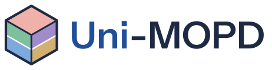
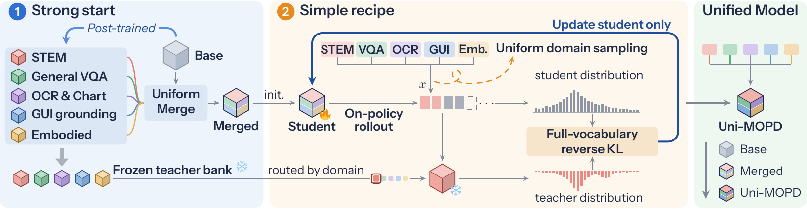

<div align="center">

<picture>
  <source media="(prefers-color-scheme: dark)" srcset="assets/uni-mopd-logo-dark.svg">
  
</picture>

# Strong Starts, Simple Recipes

### Unified Multi-Teacher On-Policy Distillation from Multimodal Specialists

[](https://arxiv.org/abs/2611.34397)
[](https://amberheart.github.io/Uni-MOPD/)
[](https://huggingface.co/collections/AmberHeart/uni-mopd)
[](https://modelscope.cn/collections/AmberHeart/Uni-MOPD)
[](LICENSE)

Wenzheng Chang<sup>1,2</sup>, Taiqiang Wu<sup>2,3</sup>, Yuqi Xu<sup>2</sup>,
Yongfu Zhu<sup>2,\*</sup>, Zelin Peng<sup>2</sup>, Ji Zhao<sup>2,4,6</sup>,
Shuai Dong<sup>2,5,6</sup>, Wenpu Liu<sup>2,7</sup>, Caoyuan Ma<sup>2,8</sup>,
Xuehui Wang<sup>2</sup>, Ziyue Wang<sup>2,7</sup>, Weichu Xie<sup>2,7</sup>,
Haiyuan Wan<sup>2,9</sup>, Ngai Wong<sup>3</sup>, Tong He<sup>2</sup>,
Wenqi Shao<sup>2,†</sup>, Jiaqi Wang<sup>2,\*</sup>

<sup>1</sup> Shanghai Jiao Tong University · <sup>2</sup> JD.COM ·
<sup>3</sup> The University of Hong Kong ·
<sup>4</sup> University of Science and Technology of China ·
<sup>5</sup> Fudan University · <sup>6</sup> SII · <sup>7</sup> Peking University ·
<sup>8</sup> The University of Tokyo · <sup>9</sup> Tsinghua University

<sub>\* Corresponding authors. † Project lead.</sub>

</div>

> The paper is on [arXiv](https://arxiv.org/abs/2611.34397) and all eight
> checkpoints are live on Hugging Face and ModelScope. See
> [REPRODUCIBILITY.md](REPRODUCIBILITY.md) for what is verifiable today.

**Uni-MOPD** unifies separately trained multimodal domain specialists into one
model with a strong start and a simple recipe: a training-free **uniform merge**
of the specialists initializes the student, and **short multi-teacher on-policy
distillation** (MOPD) with uniform domain sampling and full-vocabulary reverse
KL refines it. Five Qwen3-VL-30B-A3B specialists — STEM, visual QA,
documents/OCR/charts, GUI grounding, embodied understanding — become one
unified model. The method and the full study are presented in the
[paper](https://arxiv.org/abs/2611.34397) and on the
[project page](https://amberheart.github.io/Uni-MOPD/); this repository is the
code release.



It contains the complete training stack behind the paper:

- **MOPD training framework** for mixture-of-experts students, built on
  ms-swift, Megatron-LM, and vLLM: streamed on-policy rollouts, domain-routed
  frozen teachers swapped in from CPU memory, full-vocabulary distillation
  losses (RKL/FKL/ToDi), and R3 rollout-route replay. On the same hardware it
  trains 3.3× faster than our adapted FSDP2 build of the released Open-MOPD code
  and computes the same full-vocabulary loss 2.3× faster than an implementation
  in the verl framework.
- **Merge suite**: streaming uniform and tuned DARE merges and optional
  coefficient calibration, deterministic across worker counts.
- **Query allocation** tools for multi-domain training data.
- **The exact paper configurations** for the released checkpoint and its
  matched objective controls.
- **A CPU test suite** (195 tests, no GPU or weights) that pins the published
  recipe: merge arithmetic, objectives against closed forms, teacher routing,
  and one end-to-end distillation step.

## News

Updates land here first: model releases, framework fixes, and documentation
changes. Check back or watch the repository.

- **[2026.11.26]** 📄 Paper released on arXiv:
  [Strong Starts, Simple Recipes](https://arxiv.org/abs/2611.34397).
- **[2026.11.14]** 🤗 All eight checkpoints — six specialist teachers, the
  uniform merge, and the unified student — released in the
  [Uni-MOPD collection](https://huggingface.co/collections/AmberHeart/uni-mopd)
  on Hugging Face and on ModelScope.
- **[2026.11.13]** 🚀 Initial code release: training framework, merge suite,
  configs, and CPU test suite published in this repository.

## Contents

- [Model Zoo](#model-zoo)
- [Results](#results)
- [Installation](#installation)
- [Quick Start: Inference](#quick-start-inference)
- [Reproducing Uni-MOPD](#reproducing-uni-mopd)
- [Training Configuration](#training-configuration)
- [Repository Layout](#repository-layout)
- [Citation](#citation)
- [Acknowledgements](#acknowledgements)
- [License](#license)

## Model Zoo

Eight models are released: the unified student, its merge initialization, and
six specialist teachers. All share the Qwen3-VL-30B-A3B architecture (BF16).

| Model | Description | Hugging Face | ModelScope |
|---|---|---|---|
| **Uni-MOPD** | Final model (MOPD @50 from the uniform merge) | [HF](https://huggingface.co/AmberHeart/Uni-MOPD) | [MS](https://modelscope.cn/models/AmberHeart/Uni-MOPD) |
| Uni-MOPD-Merge | Uniform DARE merge of the five first-bank specialists (MOPD initialization) | [HF](https://huggingface.co/AmberHeart/Uni-MOPD-Merge) | [MS](https://modelscope.cn/models/AmberHeart/Uni-MOPD-Merge) |
| Uni-MOPD-Teacher-STEM | STEM reasoning specialist | [HF](https://huggingface.co/AmberHeart/Uni-MOPD-Teacher-STEM) | [MS](https://modelscope.cn/models/AmberHeart/Uni-MOPD-Teacher-STEM) |
| Uni-MOPD-Teacher-VQA | General visual QA specialist | [HF](https://huggingface.co/AmberHeart/Uni-MOPD-Teacher-VQA) | [MS](https://modelscope.cn/models/AmberHeart/Uni-MOPD-Teacher-VQA) |
| Uni-MOPD-Teacher-OCR | Document / OCR / chart specialist | [HF](https://huggingface.co/AmberHeart/Uni-MOPD-Teacher-OCR) | [MS](https://modelscope.cn/models/AmberHeart/Uni-MOPD-Teacher-OCR) |
| Uni-MOPD-Teacher-GUI | GUI grounding specialist | [HF](https://huggingface.co/AmberHeart/Uni-MOPD-Teacher-GUI) | [MS](https://modelscope.cn/models/AmberHeart/Uni-MOPD-Teacher-GUI) |
| Uni-MOPD-Teacher-Embodied | Embodied understanding specialist | [HF](https://huggingface.co/AmberHeart/Uni-MOPD-Teacher-Embodied) | [MS](https://modelscope.cn/models/AmberHeart/Uni-MOPD-Teacher-Embodied) |
| Uni-MOPD-Teacher-OCR-Bank2 | OCR specialist trained with OCR-domain SFT and RL (second-bank study) | [HF](https://huggingface.co/AmberHeart/Uni-MOPD-Teacher-OCR-Bank2) | [MS](https://modelscope.cn/models/AmberHeart/Uni-MOPD-Teacher-OCR-Bank2) |

## Results

Nineteen benchmarks are averaged within each of the five domains, then the
domain means are averaged equally (Avg., 0–100 scale, one decimal; differences
computed from unrounded scores; Avg. differences above 0.15 and domain gaps
above 0.7 exceed re-evaluation variation).

| Model | STEM | VQA | OCR | GUI | Emb. | Avg. |
|---|---:|---:|---:|---:|---:|---:|
| Base (Qwen3-VL-30B-A3B-Instruct) | 58.3 | 58.2 | 71.8 | 51.3 | 51.0 | 58.1 |
| Uniform merge (initialization) | 67.5 | 62.3 | 77.0 | 77.0 | 54.3 | 67.6 |
| **Uni-MOPD (merge + 50 MOPD updates)** | **71.0** | **64.9** | **77.8** | **78.3** | **57.1** | **69.8** |
| Best-specialist reference *(oracle: per-domain best of five models)* | 72.9 | 66.4 | 79.6 | 79.7 | 56.0 | 70.9 |

A single model covers 92% of the gap from Base to the five-model oracle, raises
every domain mean over the merge, and surpasses the oracle on embodied
understanding (57.1 vs. 56.0). Starting-point comparisons, sampling and
divergence ablations, and the second specialist bank are in the paper.

### Framework efficiency

Under matched update and query budgets (50 updates over the same 25,600 queries
from the uniform merge, 24 H200 GPUs), the released framework outperforms our
runs of the Open-MOPD recipe and trains substantially faster:

| Run | Avg. | s/update | GPU-hours @50 |
|---|---:|---:|---:|
| Open-MOPD, adapted FSDP2 build | 68.5 | 888 | 296 |
| Open-MOPD, Megatron + R3 | 68.5 | 348 | 116 |
| &nbsp;&nbsp;w/o mechanisms | 69.0 | 351 | 117 |
| **Uni-MOPD** | **69.8** | **266** | **89** |

Timed over the same updates without CPU offloading, the framework also computes
the same full-vocabulary loss 2.3× faster than a verl implementation (263.4 vs.
597.8 seconds per update). The speedup comes from the system as a whole —
logits computed only at response positions, sharded and chunked loss
computation, a teacher swapped in from CPU memory, and streamed rollouts —
rather than from the objective.

## Installation

Requires Python 3.11, a CUDA 12.8 toolkit, and cuDNN 9 development headers:
Transformer Engine, FlashAttention, and apex all compile CUDA extensions here.

```bash
git clone https://github.com/AmberHeart/Uni-MOPD.git
cd Uni-MOPD
python3.11 -m venv .venv
source .venv/bin/activate
python -m pip install --upgrade pip setuptools wheel packaging ninja
python -m pip install torch==2.8.0 torchvision==0.23.0 \
  --index-url https://download.pytorch.org/whl/cu128
python -m pip install --no-build-isolation -r requirements.txt
APEX_CPP_EXT=1 APEX_CUDA_EXT=1 python -m pip install --no-build-isolation \
  "git+https://github.com/NVIDIA/apex.git@10417aceddd7d5d05d7cbf7b0fc2daad1105f8b4"
python -m pip install -e . -e ms-swift
bash setup.sh
export MEGATRON_LM_PATH="$PWD/Megatron-LM"
```

`setup.sh` clones Megatron-LM at the pinned commit and applies
`patches/megatron-lm.patch`. **This step is mandatory, not an optimization:** the
patch adds `megatron/core/transformer/moe/routing_replay.py`, which the trainer
imports at module load, and the published recipe runs with
`mopd_router_replay: r3`.

The paper run used Python 3.11, ms-swift 3.13.0.dev0, Megatron Core 0.15.0,
vLLM 0.11.0, NCCL 2.27.3, and H200 GPUs. See
[docs/environment.md](docs/environment.md) for the pinned versions, system
prerequisites, GPU architecture build flags, and hardware adaptation.

### Verify the installation

The test suite is CPU-only and needs no weights, data, or GPU. It covers the
merge arithmetic and published recipes, the full-vocabulary RKL/FKL/ToDi
objectives against their closed forms, domain-to-teacher routing, query
allocation, and one end-to-end distillation step on a tiny student with mock
teachers:

```bash
python -m pytest tests -q
```

See [REPRODUCIBILITY.md](REPRODUCIBILITY.md) for what this verifies and which
results require the full three-node setup.

## Quick Start: Inference

The unified model loads straight from the hub (swap in the ModelScope id or a
local checkpoint directory if you prefer):
```python
from transformers import AutoModelForImageTextToText, AutoProcessor

model_id = "AmberHeart/Uni-MOPD"
processor = AutoProcessor.from_pretrained(model_id)
model = AutoModelForImageTextToText.from_pretrained(
    model_id, torch_dtype="auto", device_map="auto"
)
messages = [{
    "role": "user",
    "content": [
        {"type": "image", "image": "<local-image-path>"},
        {"type": "text", "text": "Describe the image."},
    ],
}]
inputs = processor.apply_chat_template(
    messages, tokenize=True, add_generation_prompt=True, return_tensors="pt",
    return_dict=True,
).to(model.device)
output = model.generate(**inputs, max_new_tokens=256)
print(processor.decode(output[0][inputs.input_ids.shape[1]:], skip_special_tokens=True))
```

## Reproducing Uni-MOPD

The full pipeline is: download specialists → merge → prepare queries → MOPD.
Training data is not released; [docs/data_format.md](docs/data_format.md)
specifies the expected format so you can plug in your own multi-domain queries.

### 1. Obtain the specialist bank

The five first-bank specialists are the inputs to the merge
(see [Model Zoo](#model-zoo)); each is a single download:

```bash
huggingface-cli download AmberHeart/Uni-MOPD-Teacher-STEM --local-dir models/teacher-stem
# Repeat for VQA, OCR, GUI, and Embodied.
```

Any five checkpoints that share one base model and vocabulary work here — the
merge and the distillation only require a common architecture.

### 2. Merge (uniform DARE)

```bash
bash scripts/merge.sh configs/merge/uniform.yaml
```

The paper initialization uses DARE drop rate 0.7, coefficient 0.2 per specialist,
and seed 42. `configs/merge/tuned.yaml` reproduces the coefficient-tuned
comparison. See [docs/merge.md](docs/merge.md) for the streaming implementation
and optional calibration.

### 3. Prepare queries

Each query carries a domain key that routes it to its teacher. The default
**uniform** policy gives each domain a 0.2 share, drawn at random within each
domain and shuffled globally. See
[docs/query_allocation.md](docs/query_allocation.md).

### 4. Multi-teacher on-policy distillation

```bash
bash scripts/train_unimopd.sh configs/train/unimopd_uniform_rkl.yaml
```

Start the eight-GPU rollout service first with `scripts/launch_rollout.sh`, then
run the training launcher on both training nodes. Model, teacher, data, output,
and rollout endpoints are supplied by environment variables. See
[docs/training.md](docs/training.md) for exact commands.

## Training Configuration

The effective paper recipe is explicit in
[`configs/train/unimopd_uniform_rkl.yaml`](configs/train/unimopd_uniform_rkl.yaml):

| Setting | Value |
|---|---|
| Nodes | 2 × 8 GPU training + 1 × 8 GPU rollout (24 H200) |
| Parallelism | TP2 / EP8 / ETP1 / PP1 / CP1; vLLM TP2 × DP4 |
| Batch | micro batch 1, Megatron DP8, global batch 512 = 64 microbatches/rank/update |
| Objective | response-only, full-vocabulary RKL, temperature 1, global-token normalization |
| Optimizer | AdamW, LR `3e-6` constant, no warmup, weight decay `0.01` |
| Context | prompt 20,480; total sequence 32,768 |
| Response caps | STEM 12,288; VQA 8,192; document 12,288; GUI 1,024; embodied 4,096 |
| Router | R3 rollout-route replay |

Fifty updates consume 25,600 queries. The learning rate is constant, so a
50-update horizon and a longer one share the same schedule over the first 50
updates. Image budgets are carried by each image record rather than inferred from
one global value; the effective per-domain `min_pixels`/`max_pixels` ranges are
in [docs/data_format.md](docs/data_format.md). The FKL and ToDi configs change
only the distillation objective.

## Repository Layout

```
Uni-MOPD/
├── ms-swift/          # ms-swift with MOPD trainer, teacher routing, R3, full-vocab KL
├── patches/           # Megatron-LM patch (MoE routing replay, checkpointing)
├── unimopd/merge/     # streaming DARE merge, calibration objectives and simplex solvers
├── unimopd/data/      # query allocation utilities
├── configs/           # merge and training configs used in the paper
├── scripts/           # entry points: merge, calibrate, rollout, train
├── tests/             # CPU contracts for merge, routing, objectives, and allocation
├── docs/              # installation, data format, merge, training
└── assets/            # figures used in this README
```

See [docs/repository.md](docs/repository.md) for component ownership and pinned
upstream provenance.

## Citation

```bibtex
@misc{chang2026strongstartssimplerecipes,
      title={Strong Starts, Simple Recipes: Unified Multi-Teacher On-Policy Distillation from Multimodal Specialists},
      author={Wenzheng Chang and Taiqiang Wu and Yuqi Xu and Yongfu Zhu and Zelin Peng and Ji Zhao and Shuai Dong and Wenpu Liu and Caoyuan Ma and Xuehui Wang and Ziyue Wang and Weichu Xie and Haiyuan Wan and Ngai Wong and Tong He and Wenqi Shao and Jiaqi Wang},
      year={2026},
      eprint={2611.34397},
      archivePrefix={arXiv},
      primaryClass={cs.LG},
      url={https://arxiv.org/abs/2611.34397},
}
```

## Acknowledgements

Uni-MOPD builds on [ms-swift](https://github.com/modelscope/ms-swift),
[Megatron-LM](https://github.com/NVIDIA/Megatron-LM),
[vLLM](https://github.com/vllm-project/vllm), and
[Qwen3-VL](https://github.com/QwenLM/Qwen3-VL). The merge follows task arithmetic
(Ilharco et al., 2023) and DARE ([Yu et al.,
2024](https://arxiv.org/abs/2311.03099)); ToDi follows Jung et al., 2025; rollout
routing replay follows Ma et al., 2025.

## License

Code is released under the Apache 2.0 License. ms-swift retains its Apache 2.0
license; the Megatron-LM patch is subject to the Megatron-LM license. Model
weights follow the license of Qwen3-VL.
